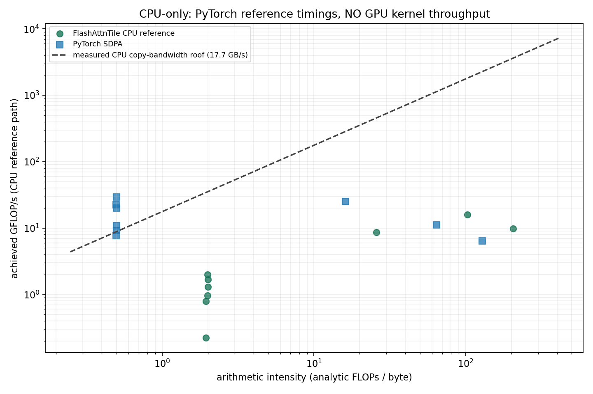

# FlashAttnTile benchmark summary

Generated: 2026-10-19T08:41:31.032546+00:00  
Artifact generated: 2026-10-19T08:40:52.072821+00:00  
Status: **no_gpu** — no CUDA device; triton not importable

## Hardware

**CPU-only, no CUDA device detected.** No GPU kernel throughput, HBM bandwidth, or FlashAttention/FlashInfer comparison was collected on this machine.
- CPU: arm (8 hardware threads)
- Measured CPU copy bandwidth: 17.7 GB/s (host DRAM, measured)
- Torch 2.11.0, Triton importable: False
- Host load average at probe time: {'1m': 22.96826171875, '5m': 18.9501953125, '15m': 12.84375}
- Timings: CPU headline latency is the **minimum** of the measured iterations (the build host was shared and heavily loaded); median/p90 are in the CSV. These are reference-path timings, not GPU kernel throughput.

## Decode

| batch | ctx | ours min (ms) | ours median (ms) | ours p90 (ms) | SDPA min (ms) | SDPA+gather (ms) | min-based speedup vs SDPA | ours TFLOP/s | max abs vs ref |
|---|---|---|---|---|---|---|---|---|---|
| 1 | 128 | 1.175 | 3.605 | 10.347 | 0.034 | 0.102 | 0.03x | 0.0002 | 0.0000 |
| 1 | 1024 | 2.182 | 3.338 | 4.669 | 0.192 | 1.020 | 0.09x | 0.0010 | 0.0000 |
| 1 | 4096 | 6.462 | 10.828 | 14.730 | 0.418 | 1.697 | 0.06x | 0.0013 | 0.0000 |
| 8 | 128 | 2.638 | 3.408 | 5.345 | 0.094 | 0.548 | 0.04x | 0.0008 | 0.0000 |
| 8 | 1024 | 8.363 | 12.403 | 19.525 | 0.571 | 2.658 | 0.07x | 0.0020 | 0.0000 |
| 8 | 4096 | 39.749 | 59.747 | 71.408 | 7.320 | 17.245 | 0.18x | 0.0017 | 0.0000 |

## Prefill

| batch | seq | ours min (ms) | ours median (ms) | ours p90 (ms) | SDPA min (ms) | min-based speedup vs SDPA | ours TFLOP/s | max abs vs ref |
|---|---|---|---|---|---|---|---|---|
| 1 | 128 | 1.955 | 8.265 | 45.255 | 0.668 | 0.34x | 0.0086 | 0.0000 |
| 1 | 512 | 16.972 | 82.408 | 274.669 | 24.052 | 1.42x | 0.0158 | 0.0000 |
| 1 | 1024 | 110.002 | 168.392 | 243.521 | 166.985 | 1.52x | 0.0098 | 0.0000 |

## Autotuning

No GPU autotuning was executed. The analytic config spaces contain 36 prefill and 16 decode candidates; shared-memory feasibility can only be evaluated against a real device. `flashattn_tile/tuned_configs.json` is therefore empty.

## Occupancy

**Not collected.** no CUDA device and no ncu binary on this host; no occupancy was measured

## Numerics

_`results/numerics.json` not produced yet._

## Test suite

_No recorded test run._

## Roofline

- Plot points: 18 measured rows; data in `roofline_data.csv`.
- Arithmetic intensity and FLOPs use the analytic formulas in `flashattn_tile/autotune.py`; GPU latency is the median of measured CUDA-event iterations, CPU latency is the minimum (see the hardware note).

